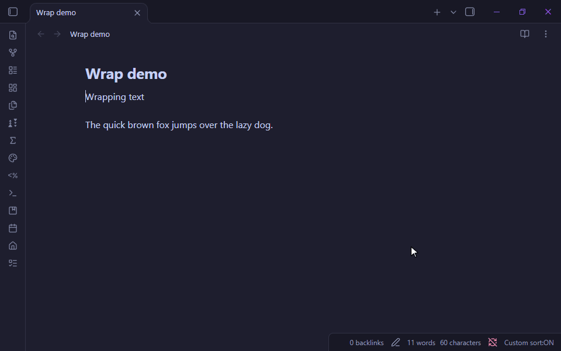

# Wrap with Hotkeys

An Obsidian plugin that wraps the selected text in tags you define, such as `<mark>…</mark>`,
`<u>…</u>` or `…`, each with its own hotkey. Press the hotkey again to unwrap.

Inspired by [Wrap with shortcuts](https://github.com/manic/obsidian-wrap-with-shortcuts). The
difference is that you set each wrapper's hotkey in the same dialog where you create it, and
new wrappers work right away, with no restart.

> This plugin was vibecoded: all of its code and this README were written by AI
> ([Claude Code](https://claude.com/claude-code)), directed and tested by Omer Cooper.

## Using it

Open **Settings → Wrap with Hotkeys** and click **+**. In the dialog:

| Field | What it does |
|---|---|
| **Name** | Shown in the command palette as "Toggle *name*" |
| **Start tag** / **End tag** | Text put before and after the selection. One of them may be empty, e.g. a start tag of `- [I]` only |
| **Hotkey** | Click it, then press a key combination such as `Ctrl+Shift+H`. **Esc** cancels, **Backspace** removes it. If another command already uses the combination, the dialog tells you which one |

The dialog shows a preview of the wrapped text. Click **Save**, then select text in a note and
press the hotkey:

- the selection is wrapped in the tags;
- if the tags are already right around the selection, or at its edges, they are removed instead.

The pencil and trash buttons edit and delete a wrapper. Each wrapper is also a command, so you
can run it from the command palette.

## Good to know

- **Hotkeys are Obsidian hotkeys.** They are saved in Obsidian's own hotkey list, so they also
  appear (and can be changed) in **Settings → Hotkeys**. The plugin reaches that list through an
  internal Obsidian object (`app.hotkeyManager`), because the public API can't set a hotkey.
- **Coming from Wrap with shortcuts?** On first run, if that plugin is installed in the vault,
  its wrappers and their hotkeys are copied over. You can then turn the old plugin off.

## Install

**With BRAT:** install [BRAT](https://github.com/TfTHacker/obsidian42-brat), run
**BRAT: Add a beta plugin for testing** and enter `OmerCooper/wrap-with-hotkeys`.

**Manually:** copy `main.js`, `manifest.json` and `styles.css` from the
[latest release](https://github.com/OmerCooper/wrap-with-hotkeys/releases/latest) into
`<vault>/.obsidian/plugins/wrap-with-hotkeys/`, reload Obsidian and turn the plugin on under
Settings → Community plugins.

## License

[MIT](LICENSE)
